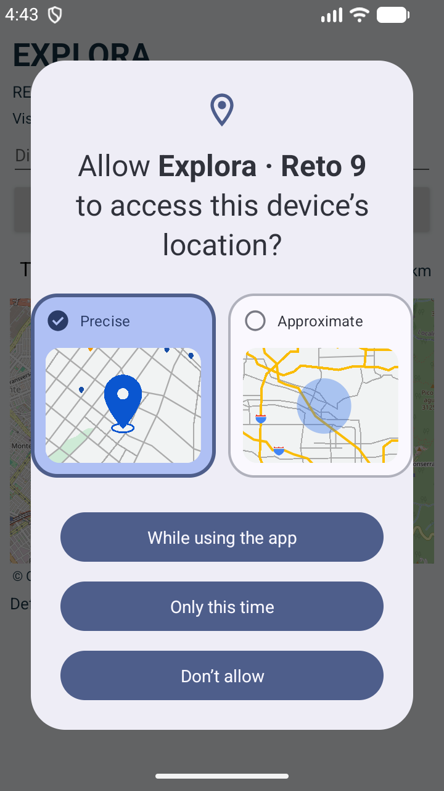
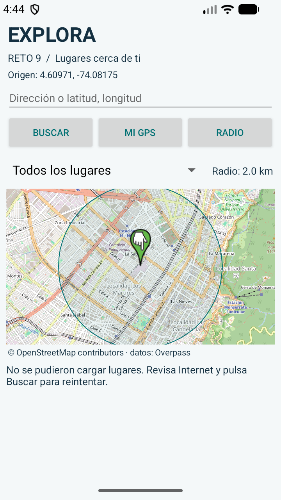
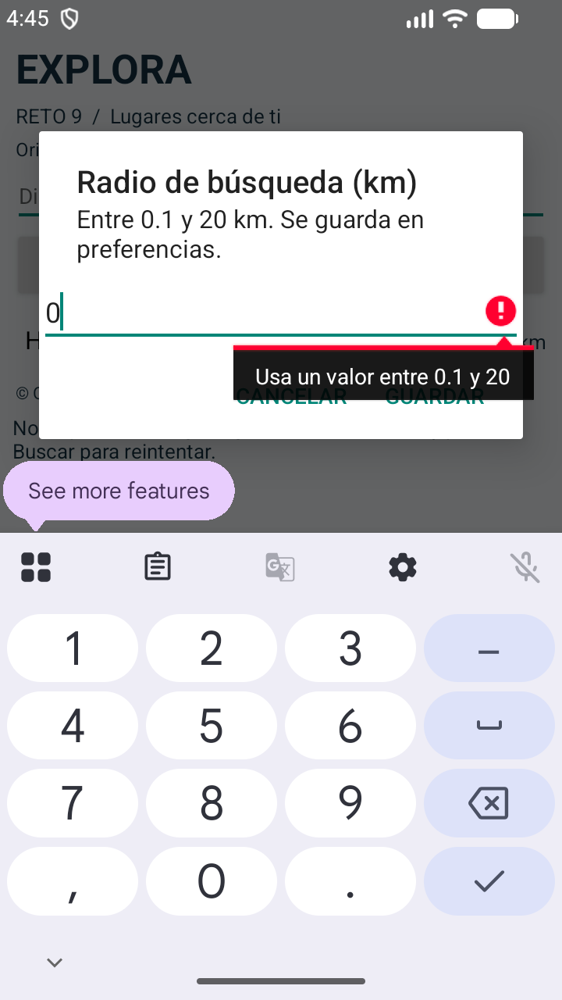
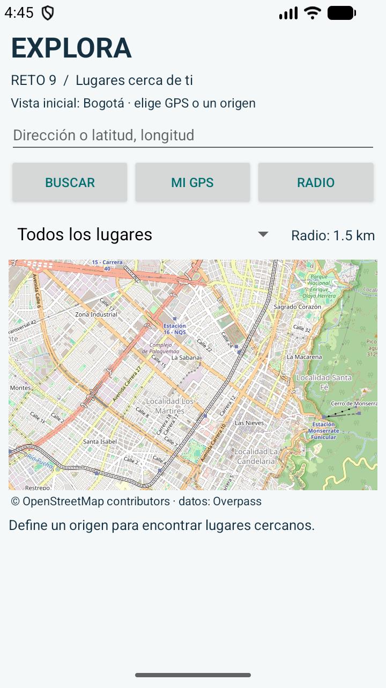

# Informe de pruebas · Reto 9

Fecha: 21 de octubre de 2026. Proyecto ejecutado e instalado en el emulador Android `Small_Phone` del SDK local. Las coordenadas de Bogotá utilizadas en las pruebas son simuladas, no una ubicación personal del usuario.

## Resultado

| Verificación | Resultado | Evidencia |
| --- | --- | --- |
| Compilar APK y APK de pruebas | Aprobado | `build-verification.log` |
| Android Lint | Sin errores; advertencias de compatibilidad, recursos de texto e icono | `lint-results-debug.html` |
| Pruebas instrumentadas de lógica | 8 de 8 aprobadas en el emulador | `instrumentation.txt` |
| Mapa OpenStreetMap visible | Aprobado | `01-inicio.png` |
| Solicitud de permisos de ubicación | Aprobado | `02-permiso-gps.png` |
| Recepción de GPS simulado de Bogotá | Aprobado | `03-gps-lugares.xml`, coordenadas `4.60971, -74.08175` |
| Rechazo de radio 0 km | Aprobado | `05-radio-invalido.png` |
| Persistencia de radio 1.5 km después de cerrar y abrir | Aprobado | `06-preferencias-persistentes.png` |
| Origen introducido por coordenadas | Interpretado correctamente | `07-coordenadas.xml` |
| Consulta real de nombres de lugares | Falló por tiempo de espera de Overpass | `03-gps-lugares.png`, `overpass-diagnostic.txt` |
| Consulta real de hospitales | Falló por tiempo de espera de Overpass | `04-hospitales.png` |
| Consulta real desde coordenadas | Falló por tiempo de espera de Overpass | `07-coordenadas.png` |

`functional-tests.txt` conserva el resultado original de la ejecución: el caso llamado «Búsqueda por coordenadas» exigía simultáneamente interpretar el origen y recibir lugares. Falló porque no llegaron los lugares; el origen sí aparece correctamente en el XML. El script se ajustó para separar ambos criterios en futuras ejecuciones.

## Ocho pruebas instrumentadas

1. Distancia cero entre coordenadas idénticas.
2. Distancia conocida de un grado de latitud (~111.195 km).
3. Límites e invalidez de coordenadas, incluido NaN.
4. Límites del radio de búsqueda.
5. Interpretación de nombres en nodos y centros de polígonos; orden por distancia.
6. Exclusión de lugares fuera del radio y sin nombre.
7. Respuesta vacía.
8. Error explícito del servidor en el campo `remark`.

Las cuatro pruebas del intérprete JSON usan datos sintéticos controlados, identificados como tales en el código. No se presentan como una consulta de red exitosa ni como evidencia de marcadores obtenidos en vivo.

## Incidencia externa y alcance

El mapa descargó teselas, el GPS entregó la posición y la app permaneció operativa. Overpass devolvió errores HTTP 502/504 o `SocketTimeoutException` durante las verificaciones. Se comprobaron varios servidores sin desactivar la validación TLS. La app conserva la ubicación, informa el fallo y permite reintentar con Buscar; también intenta un segundo servidor.

Queda pendiente una prueba exitosa de nombres y marcadores con Overpass disponible. La búsqueda por dirección está implementada, pero no fue verificada de extremo a extremo en esta sesión. Tampoco se acredita prueba en teléfono físico ni con todas las versiones soportadas de Android.

## Reproducción

Con Android Studio y el SDK configurados:

```powershell
.\gradlew.bat assembleDebug assembleDebugAndroidTest lintDebug
.\gradlew.bat connectedDebugAndroidTest
python scripts\emulator_checks.py
```

El script funcional requiere el APK instalado y una app sin permisos previamente concedidos para comprobar la solicitud inicial. Para empezar desde cero, borra los datos **solo de esta app de pruebas** desde los ajustes del emulador. El script devuelve código de salida 1 si alguna verificación falla.

Para iniciar `Small_Phone` en este equipo se desactivó Vulkan y se seleccionó SwiftShader, porque el inicio con el controlador gráfico predeterminado fallaba:

```powershell
& "$env:LOCALAPPDATA\Android\Sdk\emulator\emulator.exe" -avd Small_Phone -no-snapshot-load -gpu swiftshader -feature -Vulkan -no-audio
```

## Capturas









