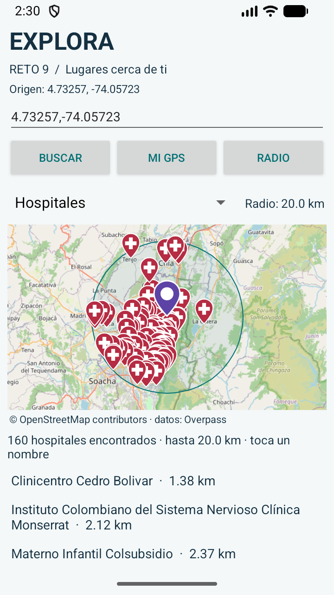
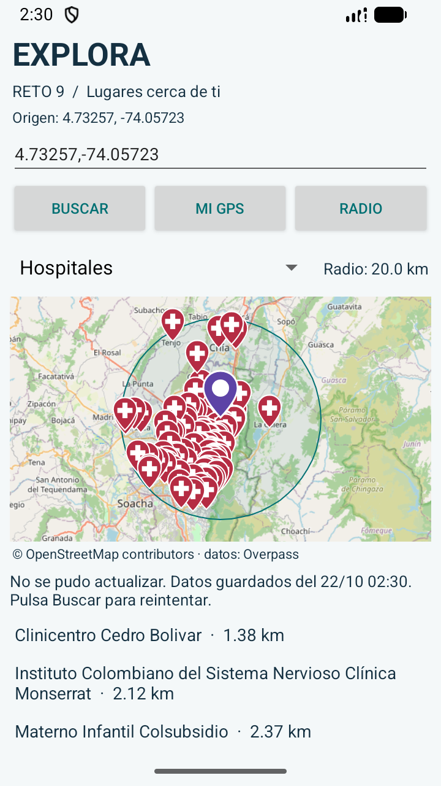

# Corrección de la búsqueda hospitalaria · versión 1.1

## Resultado comprobado en el emulador

La aplicación consultó OpenStreetMap en vivo y mostró **160 puntos hospitalarios dentro de 20 km**, desde el origen `4.73257, -74.05723` utilizado para reproducir la captura. La distancia máxima de los marcadores fue **19.94523 km**; todos cumplieron el radio. No se utilizaron resultados inventados ni un catálogo incorporado en la app.

Los primeros lugares de la respuesta ordenada por distancia fueron:

| Lugar registrado en OpenStreetMap | Distancia aproximada |
| --- | ---: |
| Clinicentro Cedro Bolivar | 1.38 km |
| Instituto Colombiano del Sistema Nervioso Clínica Monserrat | 2.12 km |
| Materno Infantil Colsubsidio | 2.37 km |
| Fundacion Neumologica | 2.69 km |
| Fundación Cardio Infantil | 2.77 km |

Los nombres se conservan tal como vienen de OSM. El conteo representa objetos/puntos hospitalarios del mapa, incluidos centros clínicos que OSM clasifica como hospital; no acredita 160 instituciones independientes ni sustituye un directorio oficial.



## Problemas corregidos

- La versión anterior esperaba 20 segundos en el cliente, aunque autorizaba 25 segundos de procesamiento al servidor. La nueva consulta permite 40 segundos al servidor y 60 segundos de espera de lectura.
- La consulta usa POST y un área rectangular calculada por índice espacial. Después se aplica el radio circular exacto por Haversine, excluyendo los puntos de las esquinas que quedan fuera de 20 km.
- Se consultan las etiquetas `amenity=hospital` y `healthcare=hospital`. La consulta ya no exige `[name]`: se admiten nombres alternativos y hospitales sin nombre, identificados explícitamente como tales.
- Se excluyen registros veterinarios identificados por sus etiquetas o su nombre, aunque estén clasificados erróneamente como hospital.
- Se intenta otro servidor cuando hay error HTTP, formato inválido o una respuesta parcial HTTP 200 con `remark`.
- Se cancelan las solicitudes reemplazadas, para que no retrasen ni sobrescriban búsquedas recientes.
- Se guarda la última respuesta por filtro. Solo se reutiliza cuando coincide exactamente la consulta —origen, radio y categoría— y no supera siete días; se informa su fecha si falla la actualización.
- El origen y el filtro persisten al reiniciar. El mapa encuadra el radio completo y usa iconos diferenciados, dejando el origen visible sobre los otros marcadores.

El mensaje original de la captura era un error de consulta: no demostraba ausencia de hospitales. Ahora se diferencia explícitamente un servicio no disponible de una consulta terminada sin resultados.

## Verificaciones

| Prueba | Resultado | Evidencia |
| --- | --- | --- |
| Compilar app y APK de pruebas | Aprobado | `build.log` |
| Android Lint | Sin errores; conserva advertencias no bloqueantes | `lint-results-debug.html` |
| Distancias, límites, intérprete, consultas y recuperación | 20 pruebas aprobadas | `regression.txt` |
| Consulta en vivo y marcadores dentro de 20 km | 1 prueba de aceptación aprobada | `live-test.txt`, `hospital-live.json` |
| Caché al desactivar la conexión del emulador | Aprobado; nombres y origen conservados, fecha visible | `cache-test.txt`, `hospital-cache.png` |

La prueba de aceptación usa la actividad real y el cliente HTTPS de Android, verifica que la consulta termine con éxito, cuenta los marcadores del mapa y comprueba la distancia de cada uno. La prueba de caché desactiva temporalmente las conexiones del emulador, reinicia la app y comprueba que el primer nombre del resultado real siga visible; restaura después las conexiones a su estado anterior.



Como diagnóstico previo, los servidores principal y VK respondieron HTTP 200 con 178 candidatos en el área rectangular, en 18.96 y 20.36 segundos respectivamente. Private.coffee agotó el tiempo de espera. Esos resultados están en `servers.json`; los candidatos se reducen al filtrar el radio circular y excluir registros veterinarios. Los tiempos y cantidades pueden cambiar con los datos y la disponibilidad del servicio.

## Reproducción

```powershell
.\gradlew.bat assembleDebug assembleDebugAndroidTest lintDebug
& "$env:LOCALAPPDATA\Android\Sdk\platform-tools\adb.exe" install -r app\build\outputs\apk\debug\app-debug.apk
& "$env:LOCALAPPDATA\Android\Sdk\platform-tools\adb.exe" install -r app\build\outputs\apk\androidTest\debug\app-debug-androidTest.apk
& "$env:LOCALAPPDATA\Android\Sdk\platform-tools\adb.exe" shell am instrument -w -e class co.edu.ucc.reto9.HospitalLiveCheck co.edu.ucc.reto9.test/android.test.InstrumentationTestRunner
```

La aceptación necesita Internet. La prueba de caché se ejecuta con `python scripts/test_hospital_cache.py`, después de copiar `hospital-live.json` de los archivos externos de la app a esta carpeta. Las pruebas de transporte usan respuestas controladas para reproducir errores, respuestas parciales y cancelación; la aceptación y sus capturas usan datos reales.
